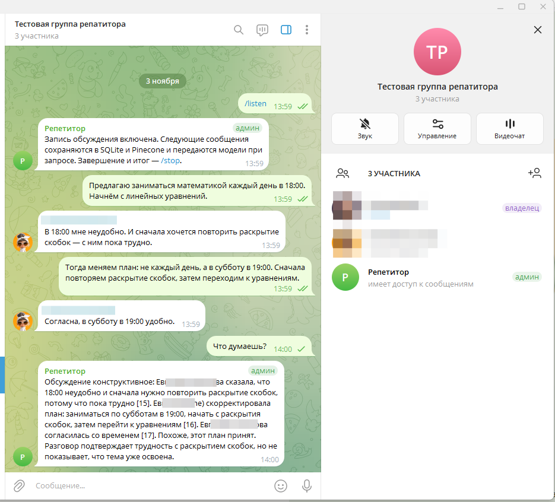
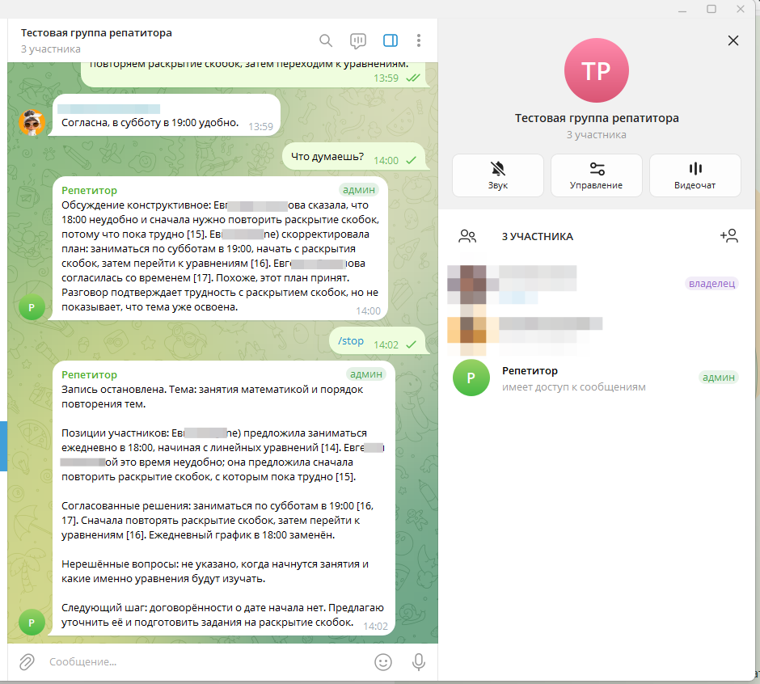

# AI для команды: помощник семейной учебной группы

## Задание

Сохранить официальный пример Extractive QA, реализовать три пайплайна
индексации, поиска и суммаризации, подключить Telegram, модель и Pinecone.
Проверить ответ «Что думаешь?» по контексту обсуждения.

## Реализация

Создан отдельный модуль проекта для семейной учебной группы: родитель
и две ученицы 7 класса обсуждают занятия. Веб-репетитор остаётся средством
индивидуального обучения; Telegram-помощник добавляет общий контекст и итоги.

Официальный notebook Extractive QA сохранён в корне вместе с источником
и лицензией. Он использован как образец устройства Pipeline, не запускался.
Рабочий код написан с помощью Codex вместо Cursor; реализованы генеративные
ответы и итоги обсуждения. Использованы ранее настроенные API/base URL,
Pinecone и multilingual-e5-large 1024/cosine вместо новой модели эмбеддингов.

Три отдельных Haystack Pipeline:

1. Подготовка сообщения с автором, временем и ID → эмбеддинг → Pinecone.
2. Поиск по текущему чату/сессии → контекст с последними репликами → ответ.
3. Полная хронология текущей сессии → резюме; длинная сессия обрабатывается
   частями с последующим объединением.

`/listen` включает запись, `/stop` останавливает её и выдаёт итог.
`/summary` возвращает итог отдельно; `/ask`, упоминание бота и «Что думаешь?»
вызывают ответ по обсуждению. `/status` показывает состояние и количество записей.
В группе начало/остановка доступны администратору. Команды и ответы бота
не сохраняются как высказывания участников. Контекст чатов и сессий разделён.

## Проверки

10 автоматических тестов пройдены: начало/остановка записи, права
администратора, вызовы и исключение сообщений бота, повторный старт,
разделение чатов/сессий, отсутствие дублей, метаданные/сохранность SQLite
и ограничение количества сообщений.

Реальная проверка Pinecone и модели выполнена на четырёх авторских репликах.
Сначала предложены ежедневные занятия в 18:00, затем участницы указали
ограничения и попросили повторить скобки. Последнее сообщение уточнило:
занятия не ежедневные, начало в субботу в 19:00, сначала скобки, потом уравнения.

На вопрос по обсуждению модель верно указала субботу, 19:00, порядок тем
и отмену ежедневного расписания, сославшись на сообщение родителя [4].
Резюме перечислило исходные позиции и итоговое уточнение. Другой чат
не получил эти сообщения. Это проверка сервисных пайплайнов. Первая проверка в Telegram выявила ошибку фильтра участников: сохранялись только реплики разрешённого аккаунта. Фильтр исправлен, добавлены два регрессионных теста; повторная групповая проверка подтвердила получение сообщений обоих участников.

### Проверка в Telegram-группе

После исправления фильтра участников начато новое обсуждение с двух аккаунтов.
Бот учёл исходное предложение, возражение второго участника, изменение плана
и явное согласие. На «Что думаешь?» сослался на сообщения [15–17] и отметил,
что обсуждение трудностей ещё не подтверждает освоение темы.

Команда `/stop` остановила запись и выдала итог: позиции участников,
смена времени с 18:00 на 19:00, сначала скобки, затем уравнения,
нерешённые вопросы и предложение следующего шага.

В ручной проверке замечена неточность: разовое «в субботу» модель пересказала
как регулярное «по субботам». В инструкцию добавлено требование сохранять
периодичность без домысливания. Скриншоты показывают результат до этого уточнения;
дополнительная реальная проверка ответа и резюме после уточнения сохранила разовое «в субботу», без «по субботам». Результат сохранён в results/schedule-check.json. Это отдельный модельный прогон, а не повторный Telegram-скриншот.

## Ограничения

До 60 текстовых сообщений по 2000 символов на обсуждение. Вложения,
редактирование сообщений и отдельные темы форума Telegram не реализованы.
При ошибке Pinecone реплика сохраняется локально, что отражается в `/status`.
Семантический поиск дополнен последними 16 репликами, а резюме охватывает
всю записанную сессию. Данные передаются Pinecone и сервису модели.

## Результат

Реализованы три пайплайна семейного помощника. Автоматические проверки
и реальные обращения к Pinecone/модели подтвердили поиск, резюме,
учёт уточнений и разделение чатов.
